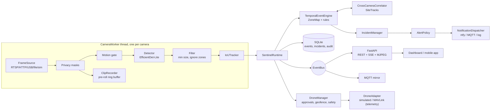

# Sentinel architecture

## Overview

Data flows one way: frames → detections → tracks → events → incidents → notifications. Every stage after tracking runs on event timestamps only, so a scenario replays deterministically (`sentinel.replay`).

## Stages

### 1. Ingestion (`sources.py`, `simulation.py`)
- `OpenCVSource` runs a reader thread that keeps only the newest frame, so a slow detector never builds up latency. It forces RTSP over TCP and reconnects with exponential backoff (1 s up to 30 s).
- `SimulatedSource` renders a scripted scenario and attaches ground-truth boxes, so the whole stack runs without cameras.
- Camera health: if a camera sends no frame for `health.camera_offline_after_s`, the runtime emits a `camera_offline` event (medium severity: a blind spot matters). When frames resume it emits `camera_online` (info).

### 2. Privacy and cost control (`vision.py`, `pipeline.py`)
- `privacy_masks` (normalized polygons) are blacked out **before** detection, recording, and streaming.
- `MotionGate` runs frame differencing on a 160x90 grayscale image. The detector runs when there is motion, when tracks are active, or at least every `idle_detect_interval_s`.
- Detections smaller than `min_box_area`, or whose ground point falls in an `ignore` zone, are dropped.

### 3. Detection (`detectors.py`)
- `Detector.detect(frame) -> list[Detection]` with normalized boxes. Labels are COCO names, folded into canonical classes: `person`, `vehicle`, `bicycle`, `animal`, `bag`.
- `MediaPipeObjectDetector` uses EfficientDet-Lite0 by default (`efficientdet_lite2` is more accurate and slower). The model downloads to `models/`. It runs in IMAGE mode.
- `detector.tiles: [cols, rows]` adds overlapping tile passes (`tile_overlap`, default 0.15) to the full-frame pass. Results are merged with per-label IoU NMS. Each tile is one more inference per frame. See ROADMAP findings for the measured recall/CPU trade-off.
- The detector score threshold is shifted by sensitivity: low +0.10, high −0.08.

### 4. Tracking (`tracker.py`)
- Matching uses constant-velocity prediction, then greedy assignment by IoU, with a centre-distance fallback for fast movers. Tracks never match across classes.
- A track is confirmed after `min_hits` matches and expires after `max_missed_ms` without one. The tracker records the displacement from a track's first position, which the engine uses to decide whether a vehicle *arrived* or was already parked.

### 5. Zones (`engine.ZoneMap`)
- Each zone belongs to one camera and has an image-space `polygon`, plus an optional `map_polygon` in site metres (x east, y south) for the map and drone targets. Zone ids are unique across the site.
- Zone types: `driveway`, `entrance`, `yard`, `perimeter`, `restricted`, `street`, `ignore`, `general`. `street` and `ignore` are *quiet* zones: rules skip them unless they name them explicitly.
- Membership uses the track's ground point (bottom-centre of the box), with hysteresis: a track counts as entered after `zone_enter_ms` inside and as exited after `zone_exit_ms` outside.
- **Visits** belong to site tracks. A dropout shorter than `presence_grace_ms` continues the same visit, so occlusions don't produce duplicate entries or reset dwell timers.

### 6. Cross-camera correlation (`correlation.py`)
A `SiteTrack` is one object across the property. A new camera track joins an existing site track only when all of these hold:
- **Re-acquisition (same camera):** the site track went inactive at most `reacquire_s` ago and the new track appears within `reacquire_distance` of where it was last seen.
- **Topology link (between cameras):** a configured link exists, the transit gap is within `[min_transit_s, max_transit_s]`, optional `from_zones`/`to_zones` constraints match, the class matches, and the subject is not still visible on another camera (unless the link is marked `overlap: true`).
- **Scoring:** score = 0.4 + 0.25·timing + 0.35·appearance, where appearance is a neutral 0.5 when no histogram is available. The best candidate must reach `min_link_confidence` **and** beat the runner-up by `ambiguity_margin`. Otherwise no merge happens: a new site track starts and records `ambiguous_with`.
- The weakest link's score becomes the site track's `link_confidence`, which feeds the confidence of cross-camera events.

### 7. Temporal rules (`engine.py`)
Every rule has `id`, `type`, `severity` (`info|low|medium|high`), and optional `classes` (default `["person"]`), `zones` / `zone_types`, `arm_modes`, `active_hours` (`{"start":"22:00","end":"06:00"}`, which can wrap midnight), `min_confidence`, and `enabled`.

| Type | Fires when | Extra keys | Fires at most |
| --- | --- | --- | --- |
| `zone_entry` | a new visit to a matching zone starts | | once per visit |
| `dwell` | a visit lasts longer than `min_dwell_s` × the sensitivity multiplier (low 1.4, normal 1.0, high 0.7) | `require_arrival` (ignore objects that were stationary from the moment they were first seen). `max_roam` (body heights): fire only if the subject's ground positions over the dwell window span at most this many body heights, so walking through or circling a large zone is not treated as lingering | once per visit |
| `repeated_presence` | `count` new visits to a zone within `window_s`, from any subjects | | once per window per zone |
| `sequence` | a site track visits `zones` in order within `within_s`; other zones may come in between | | once per site track |
| `multi_camera` | a site track is seen on at least `min_cameras` cameras within `window_s` | | once per site track |

The engine also emits one `activity` event (severity `info`) the first time a person or vehicle enters a non-quiet zone. This is the ordinary-activity log: it is stored and shown, but it never opens an incident.

### 8. Incidents and alerts (`incidents.py`)
- An event joins an open incident if it shares the site track (or a site track listed in `details.site_track_ids`), or if it is severity low or above on the same camera within `merge_window_s`. Otherwise a new incident opens, but only if the event is severity low or above.
- Severity is the maximum event severity, raised one level when `corroboration_behaviors` distinct behaviour types (default 3) appear in one incident. The title follows the most severe behaviour.
- An incident stays open while its subjects are visible, and closes after `close_after_s` of quiet.
- `AlertPolicy`: the arm mode sets the minimum severity for a notification (default disarmed none, home high, away medium). An incident notifies once, again only if its severity rises, under a global limit of `max_notifications` per `rate_window_s`. Held-back notifications are counted in the next message. An unacknowledged high incident sends one escalation after `ack_timeout_s`.
- Operator outcomes are `expected_activity`, `false_alarm`, `real_concern`, and `unclear`. They are the labels for future tuning.

### 9. Recording and storage (`recorder.py`, `store.py`)
- The pre-roll is a ring buffer of JPEG frames (`pre_roll_s`). An event in an incident starts or extends an MP4 clip, which stops after `post_roll_s` with no new triggers, or at `max_clip_s`. The writer tries H.264 (`avc1`) first and falls back to `mp4v`; many OpenCV pip wheels only provide mp4v, which browsers will not play inline, so the dashboard offers a download.
- An annotated snapshot is saved for a new incident and for any event of medium severity or above.
- SQLite tables: `events`, `incidents`, `audit` (settings changes, notifications, drone commands). An hourly purge applies `privacy.retention_days.events` and `.media`. Media paths are stored relative to `<storage.dir>/media`.

### 10. Distribution (`runtime.EventBus`, `api.py`, `mqtt.py`, `notify.py`)
- Bus topics: `event`, `incident`, `notification`, `settings`, `drone`.
- The API streams them over SSE, and `MqttPublisher` mirrors them to `<prefix>/<site_id>/<topic>`. Settings and drone topics are retained, and an LWT `status` topic reports online/offline.
- Notifiers run on a background thread. A failure in one channel never blocks the others or the video loop.

## Config reference

See `config/sentinel.example.json`. Top-level keys: `site` (id, name, `map` with `width_m`, `height_m`, `origin_geo`, `buildings`), `cameras[]` (id, name, fps, source, map pose, privacy_masks, zones), `topology.links[]`, `detector`, `tracker`, `engine`, `correlation`, `rules[]`, `incidents`, `alerts` (thresholds, rate limit, `channels[]`), `recording`, `privacy`, `health`, `storage`, `mqtt`, `api`, `settings_defaults`, `drone`. `python -m sentinel validate` checks identifiers, polygons, references between sections, rule parameters, and literal passwords.

Runtime settings (arm mode, sensitivity, notifications on/off) are changed through the API and persisted to `<storage.dir>/settings.json`.

## Threading model

- One thread per camera: the capture reader (OpenCV sources only) plus the worker.
- `SentinelRuntime` serializes engine, incident, and store access with an `RLock`.
- Separate threads handle housekeeping (1 s: expiry, incident close, escalations, camera health, retention), the drone safety loop (0.5 s), and the notification dispatcher.
- Uvicorn serves the API on its own event loop. SSE subscribers receive bus messages through `loop.call_soon_threadsafe`.

## Known limitations

- The IoU tracker swaps identities when people cross paths closely. Cross-camera linking without appearance evidence is deliberately conservative, so the same person may appear as two site tracks.
- One clip writer per camera: overlapping incidents on one camera share a clip.
- `active_hours` use the server's local time zone.
- There is a single shared API token, with no per-user accounts or roles yet (Phase 2).
- Not yet validated on real cameras at night (infrared), in rain or snow, or under headlight glare.
