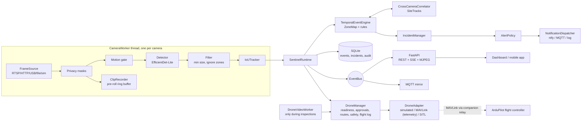

# Sentinel architecture

## Overview

Data flows one way: frames → detections → tracks → events → incidents → notifications. Every stage after tracking runs on event timestamps only, so a scenario replays deterministically (`sentinel.replay`).

## Stages

### 1. Ingestion (`sources.py`, `streams.py`, `onboarding.py`, `onvif.py`, `simulation.py`)
- Camera sources are **structured** (`host`, `port`, brand `template`, `channel`, `username`, `credential` reference, `prefer_substream`, `hw_decode`) or legacy `url` strings with `${ENV}` / `${secret:NAME}` placeholders. `streams.build_url` assembles the decoder URL at the last moment. `streams.public_source` is the only representation that may leave the process. See [camera-setup.md](./camera-setup.md).
- Source types: `rtsp`, `http` (MJPEG stream or polled JPEG `snapshot`), `usb`/`capture` (device index, backend, requested resolution), `file`, `simulated`.
- The sub-stream is used for AI when available. Hardware decoding is tried first (`hw_decode: auto`) with software fallback. Each source reports `stream`, `resolution`, `source_fps`, `hw_decode_active`, `reconnects`, and `error_kind` (classified with an RTSP-level probe).
- `OpenCVSource` runs a reader thread that keeps only the newest frame, so a slow detector never builds up latency. It forces RTSP over TCP and reconnects with exponential backoff (1 s up to 30 s).
- `SimulatedSource` renders a scripted scenario and attaches ground-truth boxes, so the whole stack runs without cameras.
- Network troubleshooting (`netdiag/`): a platform collector reads adapters, routes and firewall profiles. Probes (TCP, ICMP, SADP, ONVIF, one HTTP GET) run behind a `NetworkBackend`: `SystemNetwork` for the real network, `SimulatedNetwork` for tests and `serve --simulate-network`. Pure rules in `diagnose.py` turn observations into findings (`confirmed` / `suspected` / `ruled_out` / `info` / `ok`) with evidence and fix steps. It is read-only and probes private addresses only. The simulation is a CLI flag, not a config key. See [camera-setup.md](./camera-setup.md#network-troubleshooter).
- Camera health: see section 11. A camera counts as monitoring only while new, changing frames reach a working detector; otherwise it is `offline`, `frozen`, `ai_failed`, `restarting`, or `failed`, and the outage is recorded and, if it lasts, pushed.

### 2. Privacy and cost control (`vision.py`, `pipeline.py`)
- `privacy_masks` (normalized polygons) are blacked out **before** detection, recording, and streaming.
- `MotionGate` runs frame differencing on a 160x90 grayscale image. The detector runs when there is motion, when tracks are active, or at least every `idle_detect_interval_s`.
- Detections smaller than `min_box_area`, or whose ground point falls in an `ignore` zone, are dropped.

### 2b. Categories and environment (`models.py`, `environment.py`)
- **Categories:** `person`, `vehicle`, `bicycle`, `animal`, `bag`, `unknown_motion`, each with `detect` and `alerts`. Defaults are overridden by site `categories`, then by camera `categories`. `detect` sets the detector's class allowlist and filters boxes. With `alerts: false`, events are downgraded to `info`, so they never open incidents.
- **Environment:** `EnvironmentMonitor` classifies scene conditions (lighting change, IR mode, precipitation/noise, moving shadows, recurring motion, near-camera object) and proposes `unknown_motion` boxes. Conditions go to camera status and rate-limited `scene_condition` info events. See [environmental-intelligence.md](./environmental-intelligence.md).

### 3. Detection (`detectors.py`, `detectors_onnx.py`)
- Interface: `Detector.detect(frame) -> list[Detection]`, with normalized boxes. Labels are COCO names, folded into canonical classes: `person`, `vehicle`, `bicycle`, `animal`, `bag`.
- **Default: `{"type": "onnx", "model": "auto"}`.** `resolve_detector_settings` picks a measured profile for the machine:
  - **GPU present** (CUDA, DirectML, or OpenVINO provider installed): YOLOX-s at 960x544, threshold 0.5.
  - **CPU only:** YOLOX-tiny at 416, threshold 0.45.
  - **ONNX Runtime missing:** EfficientDet-Lite0 via MediaPipe, which is kept as the fallback.
  - Override the profiles with `detector.profiles.gpu` and `detector.profiles.cpu`.
- `OnnxDetector` decodes two model families:
  - **YOLOX:** letterbox, BGR 0–255, grid/stride decode, NMS. The official ONNX files declare a fixed 416 or 640 input, but the graph is shape-agnostic. When `input_size` differs, a resolution-flexible copy (`*.dynamic.onnx`) is written once with the `onnx` package, with the weights unchanged.
  - **DETR family** (RT-DETRv2, D-FINE, RF-DETR exports from onnx-community): resize, RGB 0–1 (ImageNet normalization for RF-DETR), sigmoid scores, no NMS needed. These have dynamic input shapes. `keep_aspect: true` keeps the frame's aspect, with the longest side set to `input_size[0]`.
- **Registry** (`detectors_onnx.MODELS`): each entry records the download URL, `license`, `training_data`, and `commercial_ok`. Only `commercial_ok` models may be shipped defaults (see `sources.md`). D-FINE is forced to CPU because its export returns corrupted outputs on DirectML.
- **Providers** (`providers`): `"auto"` (CUDA, then DirectML, then OpenVINO, then CPU), or an explicit list such as `["dml", "cpu"]`. `cpu_threads` limits ONNX intra-op threads per session.
- **Sessions are shared across cameras** running the same model, so there is one copy of the weights on the GPU. DirectML calls are serialised with a lock.
- **Thresholds:** `score_threshold` is the confidence at which a box counts as a reported detection. The sensitivity setting shifts it: low +0.10, high −0.08. The optional `low_score_threshold` also passes weaker boxes to the tracker for track extension only (see section 4).
- `min_box_area` (default 0.0004 of the frame) drops tiny boxes. The old 0.0015 discarded correctly detected distant people once the detector improved.
- `tiles: [cols, rows]` adds overlapping tile passes for any backend. Tile detections clipped at an inner tile edge are dropped when contained in another box. This was measured as inferior to a higher input resolution with YOLOX (more group-box false positives).
- `MediaPipeObjectDetector` (EfficientDet-Lite0/2) runs in IMAGE mode.

### 4. Tracking (`tracker.py`)
- Matching uses constant-velocity prediction, then greedy assignment by IoU, with a centre-distance fallback for fast movers. Tracks never match across classes.
- Optional ByteTrack-style second stage (`tracker.high_score`, set automatically from `detector.low_score_threshold`): boxes below the reporting threshold may extend an existing track by IoU, but never start one. It is measured as mixed: more alert events found, fewer identity switches with YOLOX-m, slightly more false notifications. It is opt-in.
- A track is confirmed after `min_hits` matches and expires after `max_missed_ms` without one. The tracker records the displacement from a track's first position, which the engine uses to decide whether a vehicle *arrived* or was already parked.

### 5. Zones (`engine.ZoneMap`)
- Each zone belongs to one camera and has an image-space `polygon`, plus an optional `map_polygon` in site metres (x east, y south) for the map and drone targets. Zone ids are unique across the site.
- Zone types: `driveway`, `entrance`, `yard`, `perimeter`, `restricted`, `street`, `ignore`, `general`. `street` and `ignore` are *quiet* zones: rules skip them unless they name them explicitly.
- Membership uses the track's ground point (bottom-centre of the box), with hysteresis: a track counts as entered after `zone_enter_ms` inside and as exited after `zone_exit_ms` outside.
- **Visits** belong to site tracks. A dropout shorter than `presence_grace_ms` continues the same visit, so occlusions don't produce duplicate entries or reset dwell timers.

### 6. Cross-camera correlation (`correlation.py`)
A `SiteTrack` is one object across the property. A new camera track joins an existing site track only when all of these hold:
- **Re-acquisition (same camera):** the site track went inactive at most `reacquire_s` ago and the new track appears within `reacquire_distance` of where it was last seen.
- **Topology link (between cameras):** a configured link exists, the transit gap is within `[min_transit_s, max_transit_s]`, optional `from_zones`/`to_zones` constraints match, the class matches, and the subject is not still visible on another camera (unless the link is marked `overlap: true`).
- **Scoring:** score = 0.4 + 0.25·timing + 0.35·appearance, where appearance is a neutral 0.5 when no histogram is available. The best candidate must reach `min_link_confidence` **and** beat the runner-up by `ambiguity_margin`. Otherwise no merge happens: a new site track starts and records `ambiguous_with`.
- The weakest link's score becomes the site track's `link_confidence`, which feeds the confidence of cross-camera events.

### 7. Temporal rules (`engine.py`)
Every rule has `id`, `type`, `severity` (`info|low|medium|high`), and optional `classes` (default `["person"]`), `zones` / `zone_types`, `arm_modes`, `active_hours` (`{"start":"22:00","end":"06:00"}`, which can wrap midnight), `min_confidence`, and `enabled`.

| Type | Fires when | Extra keys | Fires at most |
| --- | --- | --- | --- |
| `zone_entry` | a new visit to a matching zone starts | | once per visit |
| `dwell` | a visit lasts longer than `min_dwell_s` × the sensitivity multiplier (low 1.4, normal 1.0, high 0.7) | `require_arrival` (ignore objects that were stationary from the moment they were first seen). `max_roam` (body heights): fire only if the subject's ground positions over the dwell window span at most this many body heights, so walking through or circling a large zone is not treated as lingering | once per visit |
| `repeated_presence` | `count` new visits to a zone within `window_s`, from any subjects | | once per window per zone |
| `sequence` | a site track visits `zones` in order within `within_s`; other zones may come in between | | once per site track |
| `multi_camera` | a site track is seen on at least `min_cameras` cameras within `window_s` | | once per site track |
| `combination` | at least `min_matches` of the listed `rules` matched within `within_s`, for one linked subject (`scope: subject`) or anywhere (`scope: site`) | `rules`, `min_matches`, `scope` | once per subject / once per window |

Every rule may also set `name`, `description`, `active_days` (an overnight window belongs to the day it starts), `min_observations` (detections before it may fire), `cooldown_s` (repeats inside the cooldown are recorded as `info` with `rule_cooldown`), and `notify` (`auto`, `always`, or `never`). A `zone_entry` is judged at the moment of entry and may wait up to 15 s for enough observations, so arming later never fires for someone already inside. Arm modes are `disarmed`, `home`, `away`, `night`, and `vacation`. Each event carries `details.subject` (cameras, link scores, ambiguous candidates) and `details.observation` (track hits, box, kind) for explanations. See [intelligence.md](./intelligence.md).

The engine also emits one `activity` event (severity `info`) the first time a person or vehicle enters a non-quiet zone. This is the ordinary-activity log: it is stored and shown, but it never opens an incident.

### 8. Incidents and alerts (`incidents.py`)
- An event joins an open incident if it shares the site track (or a site track listed in `details.site_track_ids`), or if it is severity low or above on the same camera within `merge_window_s`. Otherwise a new incident opens, but only if the event is severity low or above.
- Severity is the maximum event severity, raised one level when `corroboration_behaviors` distinct behaviour types (default 3) appear in one incident. The title follows the most severe behaviour.
- An incident stays open while its subjects are visible, and closes after `close_after_s` of quiet.
- `AlertPolicy`: the arm mode sets the minimum severity for a notification (default disarmed none, home high, away medium, night medium, vacation low). A rule's `notify: never` records without pushing; `notify: always` pushes in any armed mode regardless of the level. A notification ends with a "Why: rule … matched." line before the disclaimer. An incident notifies once, again only if its severity rises, under a global limit of `max_notifications` per `rate_window_s`. Held-back notifications are counted in the next message. An unacknowledged high incident sends one escalation after `ack_timeout_s`.
- Operator outcomes are `expected_activity`, `false_alarm`, `real_concern`, and `unclear`. They are the labels for future tuning.

### 9. Recording and storage (`recorder.py`, `store.py`)
- The pre-roll is a ring buffer of JPEG frames (`pre_roll_s`). An event in an incident starts or extends an MP4 clip, which stops after `post_roll_s` with no new triggers, or at `max_clip_s`. The writer tries H.264 (`avc1`) first and falls back to `mp4v`; many OpenCV pip wheels only provide mp4v, which browsers will not play inline, so the dashboard offers a download.
- An annotated snapshot is saved for a new incident and for any event of medium severity or above.
- SQLite tables: `events`, `incidents`, `audit` (settings changes, notifications, drone commands), plus `drone_inspections` (purged with incident retention, protected with their incident), `drone_flights`, `drone_maintenance` and `drone_companions` (aircraft records, kept). An hourly purge applies `privacy.retention_days.events` and `.media`. Media paths are stored relative to `<storage.dir>/media`.

### 10. Distribution (`runtime.EventBus`, `api.py`, `mqtt.py`, `notify.py`)
- Bus topics: `event`, `incident`, `notification`, `settings`, `drone`, `drone_inspection`, `config`, `health`.
- The API streams them over SSE, and `MqttPublisher` mirrors them to `<prefix>/<site_id>/<topic>`. Settings and drone topics are retained, and an LWT `status` topic reports online/offline.
- Notifiers run on a background thread. A failure in one channel never blocks the others or the video loop.

### 11. Reliability (`health.py`, `supervisor.py`, `storage_guard.py`, `resources.py`, `backup.py`, `daemon.py`)
Full detail: [reliability.md](./reliability.md).
- `HealthMonitor` (stdlib, runs in housekeeping) derives one state per camera from the worker heartbeat, the last processed frame, `FreezeDetector` (pixel-identical frames), the detector state, and the supervisor state. It writes `camera_status[...]["health"]`, opens and closes `outages` (SQLite), writes `camera_*` / `system_health` timeline events that **never open incidents**, and sends grouped, rate-limited `kind="health"` notifications after `notify_after_s`, regardless of arm mode.
- `WorkerSupervisor` restarts crashed workers and replaces stalled ones (abandoning the stuck thread), with exponential backoff, a restart budget per window, and a cooldown circuit breaker. Too many stuck threads raise a fatal condition, so the process restarts under `sentinel run`.
- `CameraWorker` reports a heartbeat, capture-to-decision and detection latency (p50/p95), skipped frames, and detector state. Repeated GPU inference errors switch to the CPU profile; without a fallback the camera is `ai_failed` until a reloaded detector succeeds on a real frame.
- `StorageGuard` keeps free space above `storage.min_free_mb`/`min_free_pct` by deleting the oldest unprotected media, then pauses recording (detection continues). `EventStore` writes never raise; failures mark the database component degraded.
- `backup.open_store` quick-checks the database at start, applies staged restores, and replaces a damaged file with the newest verified backup. `SiteConfigManager.load_effective` falls back to `config_history/` when `site.json` is damaged.
- `RunState` (`runstate.json`) heartbeats every 10 s, so a restart can tell a planned stop from a crash and record the downtime. `daemon.supervise` (`sentinel run`) restarts the server process; Windows background start uses Task Scheduler (`sentinel service install`).

### 12. Security intelligence (`rules.py`, `rule_lab.py`, `explain.py`, `insights.py`, `reports.py`)
Full detail: [intelligence.md](./intelligence.md).
- `rules.py`: plain-language rule descriptions, templates, and the fields the builder may set. `SiteConfigManager.save_rule` / `delete_rule` / `set_rule_enabled` validate and apply live.
- `rule_lab.py`: tests a candidate rule with the real tracker, engine, incidents and alert policy (`replay.run_scenario`). Sources are a simulated walk through zones, a scripted scenario, or recorded zone visits; it uses a throwaway database.
- `explain.py`: a structured explanation for an incident, separating observed from inferred (cross-camera links, repeated visits, site-wide combinations).
- The engine emits completed zone **visits** and **trips** (`drain_activity`), stored in SQLite `visits` / `trips` with no images, positions or identities. `insights.py` computes descriptive patterns, explained unusual observations, and suggestions that need the owner's approval; none of it raises alerts.
- `reports.py`: per-rule and per-camera nuisance rates from feedback, missed-event reports, and incident exports with SHA-256 evidence fingerprints (`evidence` table, written when a clip or snapshot is finished).

### 13. Installation and devices (`devices.py`, `planner.py`, `installation.py`)
Full detail: [installation.md](./installation.md).
- `devices.py` (stdlib): device categories and capabilities, hardware compatibility profiles with support levels, `validate_devices`, and live entries per camera/device with a `level` (`registered` → `connected` → `video` → `ai_verified`) earned only from received data. `SimulatedSensors` gives simulated sensors check-ins and battery.
- `planner.py` (stdlib): plan validation, coverage on a grid with line of sight, the benchmark-based detection range, recommendations, equipment estimates, checklists, and the printable report.
- `installation.py` (stdlib): `InstallationManager` persists the journey in `<storage>/installation.json` (separate from the site config, so planning never restarts cameras), and `readiness()` turns live devices, health and config into checks and a plain statement.
- `SentinelService` holds the drone fleet (`drones`, `primary_drone`; `runtime.drone` is the primary), rebuilt from config changes unless a drone is airborne, and the simulated sensors (stepped by the drone loop, which now always runs).

### 14. Sentinel AI Guide (`assistant/`)
Full detail: [assistant.md](./assistant.md).
- `assistant/tools.py`: a fixed tool set over existing services: `read` tools (live data), `ui` tools (buttons, cards, the secure sign-in form) and `propose` tools that store a pending proposal; `Toolbox.apply` runs a confirmed proposal through the existing validated backend calls.
- `assistant/core.py`: conversations, the provider tool loop (bounded rounds, append-only history), fallback to the built-in guide, confirmations and follow-ups computed from backend results.
- `assistant/guide.py`: the deterministic built-in guide over the same tools. `assistant/provider.py`: provider interface, selection and the Anthropic implementation (optional `anthropic` SDK). `assistant/deepseek.py`: DeepSeek over its OpenAI-format Chat Completions API (`httpx`), translating messages, tool calls and `reasoning_content`. `assistant/privacy.py`: secret scrubbing and address placeholders. `assistant/store.py`: conversations under `<storage>/assistant/`. `assistant/routes.py`: `/api/v1/assistant`.
- Settings: the `assistant` config section (validated in `assistant/settings.py`); provider keys live in the credential store or `DEEPSEEK_API_KEY` / `ANTHROPIC_API_KEY`.

## Configuration editing (`site_config.py`, `credentials.py`)
- `SiteConfigManager` owns the editable config. `load_effective` prefers `<storage>/site.json` over the file the service was started with (which is never modified). Every mutation is validated as a whole, written atomically (10 backups in `config_history/`), and then passed to `SentinelService.apply_config`.
- `apply_config` → `SentinelRuntime.reconfigure`: rebuilds the engine (zones, rules, topology, correlator), alert policy, and incident settings. It keeps open incidents, settings, and history. In-flight tracks restart because zone geometry may have changed. Only camera workers whose config changed are restarted.
- The managed copy keeps `${ENV}` placeholders unresolved, so environment secrets are never written to disk by the editor. Passwords live in `SecretStore` (DPAPI on Windows, a 0600 file elsewhere).

## Config reference

See `config/sentinel.example.json`. Top-level keys: `site` (id, name, `map` with `width_m`, `height_m`, `origin_geo`, `buildings`, `image`), `categories`, `environment`, `cameras[]` (id, name, fps, source, map pose, privacy_masks, zones, optional `recorder`; the list may be empty), `devices[]` (recorders, drones, docks, sensors: `id`, `category`, `name`, `profile`, `simulated`, `map`, `zone_id`, and per category `host`/`channels`/`model`, `adapter`/`connection`/`indoor`/`drone_model`/`drone_options`/`video` (set through the write-only `video_url`), `drone_id`), `topology.links[]`, `detector`, `tracker`, `engine`, `correlation`, `rules[]`, `incidents`, `alerts` (thresholds, rate limit, `channels[]`), `recording`, `privacy` (including `retention_days.protected`), `health` (timeouts, notifications, `supervisor`, `process`, `heartbeat`), `storage` (dir, free-space thresholds, `max_media_gb`, `backups`), `logging`, `mqtt`, `api`, `settings_defaults`, `assistant` (AI Guide provider settings; never a key), `drone` (plus `device` for the primary registered drone and `inspection_points[]`; when enabled it needs `site.map.origin_geo` and a `geofence`). An ntfy channel may use `topic_credential` (a credential-store entry) instead of `topic`. The reliability keys are listed in [reliability.md](./reliability.md#configuration-reference). Simulated cameras accept `source.faults` for failure testing. `python -m sentinel validate` checks identifiers, polygons, references between sections, rule parameters, and literal passwords.

Drone keys (`drone.adapter`, `connection`, `allow_flight_commands` (SITL only), `gcs_system_id`, `firmware_tested`, `drone_model`, and the extended `safety`, `weather` and `video`) are described in [drone-integration.md](./drone-integration.md#configuration). A drone's model (`drone/catalog.py`, [drone-models.md](./drone-models.md)) supplies defaults for weather limits, the simulator, camera geometry and tested firmware; explicit config values win.

Runtime settings (arm mode, sensitivity, notifications on/off) are changed through the API and persisted to `<storage.dir>/settings.json`.

## Threading model

- One thread per camera: the capture reader (OpenCV sources only) plus the worker, owned by `WorkerSupervisor`.
- `SentinelRuntime` serializes engine, incident, and store access with an `RLock`.
- Separate threads handle housekeeping (1 s: supervision, expiry, incident close, escalations, camera health; 10 s: run-state heartbeat; 15 s: resource sampling; 60 s: storage guard; hourly: retention; daily: backup, on its own short-lived thread), the drone safety loop (0.5 s), and the notification dispatcher.
- Under `sentinel run`, a separate supervisor process owns the server process.
- Uvicorn serves the API on its own event loop. SSE subscribers receive bus messages through `loop.call_soon_threadsafe`.

## Known limitations

- The IoU tracker swaps identities when people cross paths closely. Cross-camera linking without appearance evidence is deliberately conservative, so the same person may appear as two site tracks.
- One clip writer per camera: overlapping incidents on one camera share a clip.
- `active_hours` use the server's local time zone.
- There is a single shared API token, with no per-user accounts or roles yet (Phase 2).
- Not yet validated on real cameras at night (infrared), in rain or snow, or under headlight glare.
